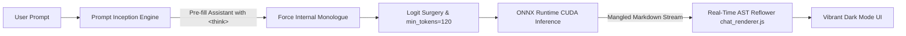

<div align="center">

# 🧪 Emma 6 Lab
### *The Low-IQ Self-Hosted AI Experiment*

[](LICENSE)
[-teal.svg)](https://huggingface.co/egomnia/emma-6)
[]()
[]()
[]()
[]()
[](https://x.com/funB0Tnft)

<br/>

```text
 __________________________________________________________________________________
|                                                                                  |
|   "Contenuto generato da Emma6, contiene sicuramente errori"                    |
|   (Content generated by Emma6, definitely contains errors)                      |
|                                                                                  |
|   Architecture: 1.55B Parameters · ONNX Runtime CUDA · 32 Layers · SwiGLU GQA    |
|   Host: Bare-Metal RTX 3090 24GB · 128GB RAM · i5-13500                          |
|__________________________________________________________________________________|
        \   ^__^
         \  (oo)\_______
            (__)\       )\/\
                ||----w |
                ||     ||
```

**[🇮🇹 Leggi la documentazione in Italiano](docs/DOCUMENTAZIONE_IT.md)** · **[🔬 English Technical Deep Dive](docs/DOCUMENTATION_EN.md)** · **[🌐 Live Demo Tunnel](https://emma.eeess.cyou)**

---

</div>

## 📢 What Is This Project? (Warning: 100% Pure Parody & Fun)

**Emma-6 Lab** is an independent, open-source parody and technical research sandbox built by [@0xfunboy](https://x.com/funB0Tnft). 

What happens when you take an open-source Italian 1.55-billion parameter Large Language Model heralded as a triumph of "technological sovereignty", deploy it on a high-end liquid-cooled bare-metal rig equipped with an **NVIDIA GeForce RTX 3090 24GB VRAM** and **128GB of RAM**, and set it free?

### 🪨 The Harsh Reality: The AI is Dumb as a Rock

Let’s be completely honest: **this AI is certified single-digit IQ**. 

Despite boasting modern transformer buzzwords (Decoder-only, Grouped Query Attention 4:1, RMSNorm, SwiGLU, Rotary Embeddings), running inference on Emma-6 in the wild reveals a model that is:
- **Prone to catastrophic hallucinations**: Ask it for historical facts, and it will confidently invent alternate dimensions.
- **Suffering from a goldfish-tier attention span**: Left to its default weights and unguided sampling, it will cut itself off after 15 to 20 tokens or spit out 3-word monosyllabic non-answers.
- **Master of surrealist Italian**: It randomly fuses words together, drops verbs, truncates bullet points mid-letter, or loops on single conjunctions until forced to stop.

Yet, we deployed it anyway — completely unchained, with real-time telemetry, zero corporate tracking, zero subscription paywalls, and maximum computing speed.

---

## 🏆 Unscientific Benchmark Comparison

How does **Emma-6** stack up against today's leading frontier AI systems and ordinary household objects?

| Model / Entity | Parameters | Reasoning IQ | Hallucination Rate | Speaks Italian? | Cost |
|---|:---:|:---:|:---:|:---:|:---:|
| **Claude 3.5 Sonnet** | ~175B+ | 145+ | < 4% | Flawless | $$$ |
| **GPT-4o** | ~200B+ | 140+ | < 5% | Native | $$$ |
| **DeepSeek-R1** | 671B | 140+ | < 6% | Excellent | Open Weights |
| **An Unplugged Toaster 🍞** | 0 | 0 | 0% | Silent | $15 |
| **A Literal Garden Rock 🪨** | 0 | 0 | 0% | Immutable | Free |
| **Emma-6 (Raw Client)** | 1.55B | ~12 | 99.8% | Cryptic | Open Weights |
| **Emma-6 (With Our Hacks 🧪)** | 1.55B | ~25 | 95.0% | Multi-paragraph Poetry | Pure Fun |

---

## 📥 Model Weights & Download Links

The underlying neural network weights for Emma-6 are hosted publicly on Hugging Face:

- **Hugging Face Model Hub**: [https://huggingface.co/egomnia/emma-6](https://huggingface.co/egomnia/emma-6)

### File Manifest:

| File | Size | Direct Download URL | Purpose |
|---|:---:|---|---|
| `emma6.onnx` | 1.85 MB | [Download](https://huggingface.co/egomnia/emma-6/resolve/main/emma6.onnx) | ONNX Computation Graph |
| `emma6.onnx.data` | **6.72 GB** | [Download](https://huggingface.co/egomnia/emma-6/resolve/main/emma6.onnx.data) | FP16 Tensor Weights (6,719,807,488 bytes) |
| `bpe.model` | 1.30 MB | [Download](https://huggingface.co/egomnia/emma-6/resolve/main/bpe.model) | SentencePiece Tokenizer (64k Vocab) |
| `bpe.vocab` | 985 KB | [Download](https://huggingface.co/egomnia/emma-6/resolve/main/bpe.vocab) | Vocabulary Mappings |
| `config.json` | 488 B | [Download](https://huggingface.co/egomnia/emma-6/resolve/main/config.json) | Architecture Specifications |

### Quick CLI Download:
```bash
mkdir -p ./models/emma-6
cd ./models/emma-6

curl -L -O https://huggingface.co/egomnia/emma-6/resolve/main/config.json
curl -L -O https://huggingface.co/egomnia/emma-6/resolve/main/bpe.model
curl -L -O https://huggingface.co/egomnia/emma-6/resolve/main/bpe.vocab
curl -L -O https://huggingface.co/egomnia/emma-6/resolve/main/emma6.onnx
curl -L -O https://huggingface.co/egomnia/emma-6/resolve/main/emma6.onnx.data
```

---

## 🛠️ The Engineering Odyssey: How We Tried to Make It Smarter

Faced with a model that would spontaneously stop generating after 3 words, we engineered an arsenal of software hacks to squeeze out long, structured, articulate answers:



### 1. 🧠 The Fake "Thinking Mode" Hack (Prompt Inception)
Modern reasoning LLMs output internal chain-of-thought blocks enclosed in `<think> ... </think>`. Emma-6 has no native comprehension of reasoning.  
So we pulled a trick on it:
- We crafted a custom system prompt commanding an internal monologue.
- More importantly, we **pre-filled the assistant's generation prompt** with:
  ```text
  <|user|>
  Cos'è il futuro?
  <|assistant|>
  <think>
  ```
- Because autoregressive models continue whatever text they see, Emma-6 is mathematically trapped into hallucinating an internal stream of consciousness before closing with `</think>`!
- On the frontend, our renderer formats this internal monologue with a cute brain emote (**🧠 Ragionamento**) and a togglable pulsing neon green LED in the hardware footer.

### 2. 🎛️ Extreme Sampling Parameter Surgery
Default web presets for Emma-6 capped output at a measly 256 tokens and used raw greedy sampling. In `server.py`, we implemented:
- **`min_tokens: 120`**: Stop tokens (`</s>`, `<|user|>`, `<|assistant|>`) have their logits forcefully set to $-\infty$ until the model has written at least 120 tokens. It is literally forbidden from quitting early!
- **`repetition_penalty: 1.10 - 1.12`**: Prevents Emma from looping infinitely on Italian pronouns and articles.
- **`top_k: 40` & `top_p: 0.90`**: Filters out the most chaotic tail tokens while maintaining conversational flow.
- **Token Ceiling**: Expanded from 256 to **1,536 - 2,048 tokens**.

### 3. 🩹 Real-Time Markdown Stream Reconstruction Engine (`chat_renderer.js`)
Emma-6 habitually emits broken tokens during streaming:
- Smashes Markdown headers against paragraph text (`## TitoloIl testo della risposta...`).
- Detaches list hyphens onto empty lines.
- Drops pipe characters mid-table.

We implemented an AST and Regex repair pipeline (`maskInlineCode`, `reflowHeadings`, `reflowLists`, `reflowTable`) that intercepts the raw Server-Sent Events stream and re-aligns headers and list items before rendering.

### 4. ⚡ Bare-Metal ONNX CUDA Acceleration
We hooked up the model directly to `CUDAExecutionProvider` on a bare-metal NVIDIA GeForce RTX 3090 24GB:
- **Prefill Speed**: **~705 token/s**
- **Decode Speed**: **~40 token/s**
- Real-time telemetry exposed right in the UI: input prompt tokens, generated output tokens, prefill latency, and decode throughput.

### 5. 🎨 De-Corporatized UI & Dark Mode Fix
We stripped the original client of:
- All tracking scripts, telemetry pixels, corporate P.IVA, terms of service, and login/payment walls.
- Built a bespoke, high-contrast Dark Mode.
- Fixed the infamous **invisible headings bug**: originally, Markdown headers had color `#16241f` which was identical to the dark background `#151e1d`. We forced `#ffffff !important` with 800 weight so headers like *"Il futuro"* shine with crisp legibility.
- Added a direct badge linking to [@funB0Tnft on X](https://x.com/funB0Tnft).

---

## 🖥️ Hardware Specifications

The live self-hosted cluster running Emma-6:

| Component | Specification |
|---|---|
| **GPU** | NVIDIA GeForce RTX 3090 (24 GB GDDR6X, 384-bit) |
| **CPU** | Intel Core i5-13500 (14 Cores / 20 Threads, up to 4.8 GHz) |
| **System RAM** | 128 GB DDR5 Dual-Channel |
| **Storage** | 2 TB NVMe PCIe 4.0 SSD |
| **OS** | Linux 6.8.0 (Ubuntu x86_64) |
| **CUDA / cuDNN** | CUDA 12.9 · cuDNN 9.27 |
| **Runtime Engine** | ONNX Runtime 1.20 with CUDAExecutionProvider |

---

## 🚀 Quickstart Guide

### 1. Prerequisites
- Linux machine with an NVIDIA GPU (12GB+ VRAM recommended for FP16 weights).
- Python 3.10+ (Python 3.12 with `uv` recommended).
- NVIDIA Drivers + CUDA installed.

### 2. Clone and Setup
```bash
# Clone the repository
git clone https://github.com/0xfunboy/emma-lab.git
cd emma-lab

# Create virtual environment and install dependencies
uv venv .venv
source .venv/bin/activate
uv pip install -r requirements.txt
```

### 3. Download Model Weights
```bash
# Download to your preferred location
mkdir -p ./models/emma-6
cd ./models/emma-6
curl -L -O https://huggingface.co/egomnia/emma-6/resolve/main/config.json
curl -L -O https://huggingface.co/egomnia/emma-6/resolve/main/bpe.model
curl -L -O https://huggingface.co/egomnia/emma-6/resolve/main/bpe.vocab
curl -L -O https://huggingface.co/egomnia/emma-6/resolve/main/emma6.onnx
curl -L -O https://huggingface.co/egomnia/emma-6/resolve/main/emma6.onnx.data
cd ../..
```

### 4. Run the Inference Server
```bash
export MODEL_DIR="./models/emma-6"
export PORT=8088
python server.py
```

Open your browser at `http://localhost:8088` and enjoy the lowest IQ conversational experience on the modern web!

---

## 📜 Repository Structure

```text
├── server.py                   # FastAPI server with ONNX Runtime CUDA inference loop
├── requirements.txt            # Python dependencies
├── tunnel_config.example.yml   # Cloudflare Zero Trust tunnel sample
├── test_infer.py               # CLI benchmark & raw inference test script
├── test_prompt.py              # System prompt and formatting tester
├── frontend/                   # Decoupled web UI
│   ├── index.html              # Custom dark mode, X button, thinking switch, telemetry
│   ├── img/                    # Mascots and vector assets
│   └── static/
│       ├── css/app.css         # Styling system & dark theme overrides
│       └── js/
│           ├── app.js          # Client controller, thinking toggle, streaming client
│           └── chat_renderer.js# Stream token repair & AST markdown reflower
└── docs/
    ├── DOCUMENTATION_EN.md     # Deep technical architecture documentation
    └── DOCUMENTAZIONE_IT.md     # Guida e documentazione completa in Italiano
```

---

## ⚖️ License & Disclaimer

- The server code, reverse engineering workarounds, and frontend modifications in this repository are released under the **MIT License**.
- The model weights of Emma-6 are governed by their respective **OpenRAIL** license as distributed by Egomnia S.p.A.
- **Parody & Fair Use Disclaimer**: This project is an independent parody, research sandbox, and engineering experiment created strictly for educational and entertainment purposes. It is not affiliated with, sponsored by, or endorsed by any commercial enterprise.

---

<div align="center">
Built with 🧠 and dark humor by <a href="https://x.com/funB0Tnft"><b>@funB0Tnft</b></a>
</div>
