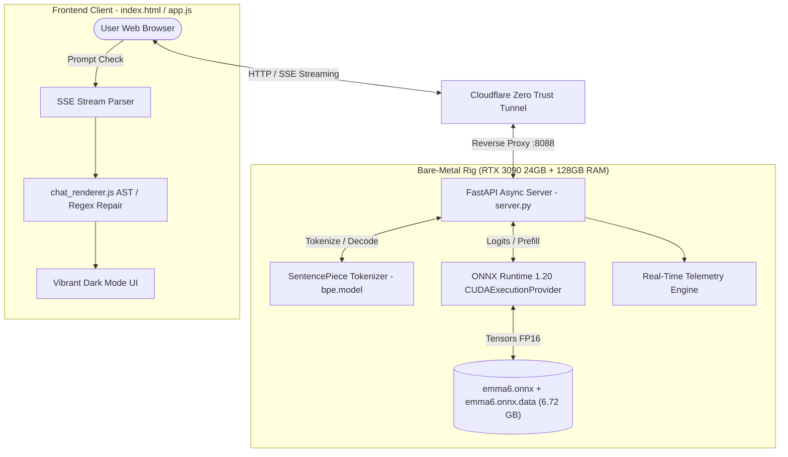

# 🔬 Emma 6 Lab — Technical Architecture & Deep Dive (English)

> **"Content generated by Emma6, definitely contains errors."**  
> *— The official honesty badge displayed under every single response.*

---

## 1. System Overview

**Emma 6 Lab** is a high-performance, self-hosted bare-metal inference platform and decoupled web client engineered to benchmark and experiment with the open-weights **Emma-6** Italian conversational model.

While modern frontier models (GPT-4o, Claude 3.5 Sonnet) possess sophisticated spatial, mathematical, and deductive reasoning capabilities, **Emma-6 is delightfully, certified single-digit IQ**. It is prone to erratic hallucinations, truncated monologues, and bizarre syntactical inventions.

This repository documents the end-to-end technical infrastructure built to host Emma-6 on enterprise hardware and the algorithmic interventions created to coerce coherent, multi-paragraph Italian output from an inherently erratic neural graph.



---

## 2. Neural Architecture of Emma-6

Emma-6 is structured as a decoder-only autoregressive Transformer with grouped query attention:

- **Parameter Count**: ~1,548,879,872 (1.55 Billion)
- **Precision**: Float16 (weights stored across `emma6.onnx.data`)
- **Vocabulary Size**: 64,000 tokens (SentencePiece BPE)
- **Context Length**: 4,096 tokens
- **Hidden Dimension ($d_{\text{model}}$)**: 2,048
- **Transformer Layers**: 32
- **Attention Heads**: 32 query heads, 8 key/value heads (Grouped Query Attention ratio 4:1)
- **Head Dimension**: 64
- **Feed-Forward Activation**: SwiGLU (multiplier 8/3, intermediate dimension 5,504)
- **Normalization**: Root Mean Square Normalization (RMSNorm)
- **Position Encoding**: Rotary Position Embeddings (RoPE, $\theta = 500,000$)
- **Embedding Scheme**: Tied input/output embeddings

---

## 3. The Low-IQ Dilemma & Engineering Workarounds

When evaluated in raw greedy decoding or out-of-the-box sampling, Emma-6 presents severe functional challenges:

| Defect Observed | Root Cause | Engineering Solution Implemented |
|---|---|---|
| **Premature Termination** | The model outputs `</s>` (EOS, ID 3) or `<|user|>` (ID 7) after only 10-25 tokens. | **Enforced Minimum Generation Window**: Logits for stop tokens $\{3, 7, 8\}$ are explicitly clamped to $-\infty$ until the sequence reaches `step >= min_tokens` ($120$ in thinking mode, $70$ in balanced mode). |
| **Monosyllabic Answers** | Client presets defaulted to tiny 256 token ceilings with no systemic depth encouragement. | **Deep System Prompt Framing**: Injected role definitions commanding step-by-step analytical exposition, with automatic token budget expansions up to 2,048 tokens. |
| **No Reasoning Engine** | The model was trained with plain SFT and possesses zero internal chain-of-thought understanding. | **Forced Monologue Injection ("Thinking Mode")**: We pre-fill the assistant output buffer with `<think>\n`. The autoregressive transformer is statistically forced to continue the monologue until it produces `</think>`. |
| **Stochastic Repetition Loops** | The model frequently repeats the same conjunction or adjective until context exhaustion. | **Dynamic Repetition Penalty (1.10–1.12)**: Applied directly on logits during the unrolled sampling loop in `server.py`. |
| **Mangled Markdown Tokens** | Sentence boundaries and token merges often emit strings like `## TitoloTesto` or detached list hyphens `- `. | **Stream AST Reconstruction Pipeline (`chat_renderer.js`)**: Real-time Regex masking and whitespace boundary separation before passing to `markdown-it`. |
| **Dark Theme Invisibility** | The CSS rendered headings as `div.md-heading` with color `#16241f`, which was identical to `#151e1d` background. | **Forced Contrast CSS Overrides**: Specific CSS rules ensuring `.md-heading`, `.md-heading--1..6` and `[role="heading"]` display crisp `#ffffff !important` with 800 font weight. |

---

## 4. Server & Inference Pipeline

The core server is written in Python using **FastAPI**, **ONNX Runtime GPU**, and **NumPy**.

### Token Generation Loop:
```python
# 1. Prefill
inp = np.array([curr_ids], dtype=np.int64)
outputs = await loop.run_in_executor(None, lambda: ort_session.run(["logits"], {"input_ids": inp}))
logits = outputs[0][0, -1, :]

# 2. Autoregressive Decode with Penalty & Minimum Token Guard
for step in range(max_tokens):
    logits_mod = logits.astype(np.float64)
    for prev_id in set(generated_tokens):
        if logits_mod[prev_id] > 0:
            logits_mod[prev_id] /= rep_penalty
        else:
            logits_mod[prev_id] *= rep_penalty

    if step < min_tokens:
        for sid in stop_token_ids:
            logits_mod[sid] = -np.inf

    next_id = sample_token(logits_mod, temperature=temp, top_p=top_p, top_k=top_k)
    if (step >= min_tokens and next_id in stop_token_ids) or next_id == eos_id:
        break
    
    # Incremental decode and yield over SSE / NDJSON
    ...
```

### Telemetry Output
Each completed generation streams a final JSON payload containing precise hardware latency metrics:
- `prompt_tokens`: Count of encoded input tokens
- `output_tokens`: Count of decoded output tokens
- `prefill_ms` & `prefill_tok_s`: Time spent and throughput during prompt ingestion
- `decode_tok_s`: Sustained generation speed during the autoregressive phase
- `generation_ms`: Total end-to-end request latency

---

## 5. API Reference

### 1. `POST /api/chat/stream`
Streams token deltas using line-delimited JSON (`application/x-ndjson`).

**Request Body:**
```json
{
  "message": "Cos'è l'universo?",
  "history": [
    {"user": "Ciao", "assistant": "Ciao! Come posso aiutarti?"}
  ],
  "preset": "thinking",
  "max_new_tokens": 1536
}
```

**Stream Chunks:**
```json
{"type": "meta", "model": "emma-6", "prompt_tokens": 48}
{"type": "delta", "content": "<think>\n"}
{"type": "delta", "content": "L'universo "}
{"type": "delta", "content": "è tutto ciò "}
{"type": "done", "response": "...", "stats": {"prefill_tok_s": 705.2, "decode_tok_s": 39.8, "generation_ms": 1920}}
```

### 2. `GET /api/models`
Returns currently active models and parameter specs.

---

## 6. Bare-Metal Host Environment

- **Operating System**: Linux 6.8+ (x86_64)
- **GPU**: NVIDIA GeForce RTX 3090 (24 GB GDDR6X, 384-bit)
- **CPU**: Intel Core i5-13500 (14 cores, 20 threads)
- **RAM**: 128 GB DDR5
- **CUDA Runtime**: 12.9
- **cuDNN**: 9.27
- **Execution Provider**: `CUDAExecutionProvider` via ONNX Runtime 1.20
